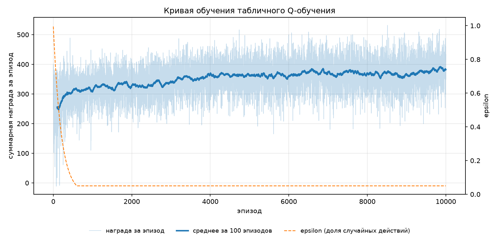
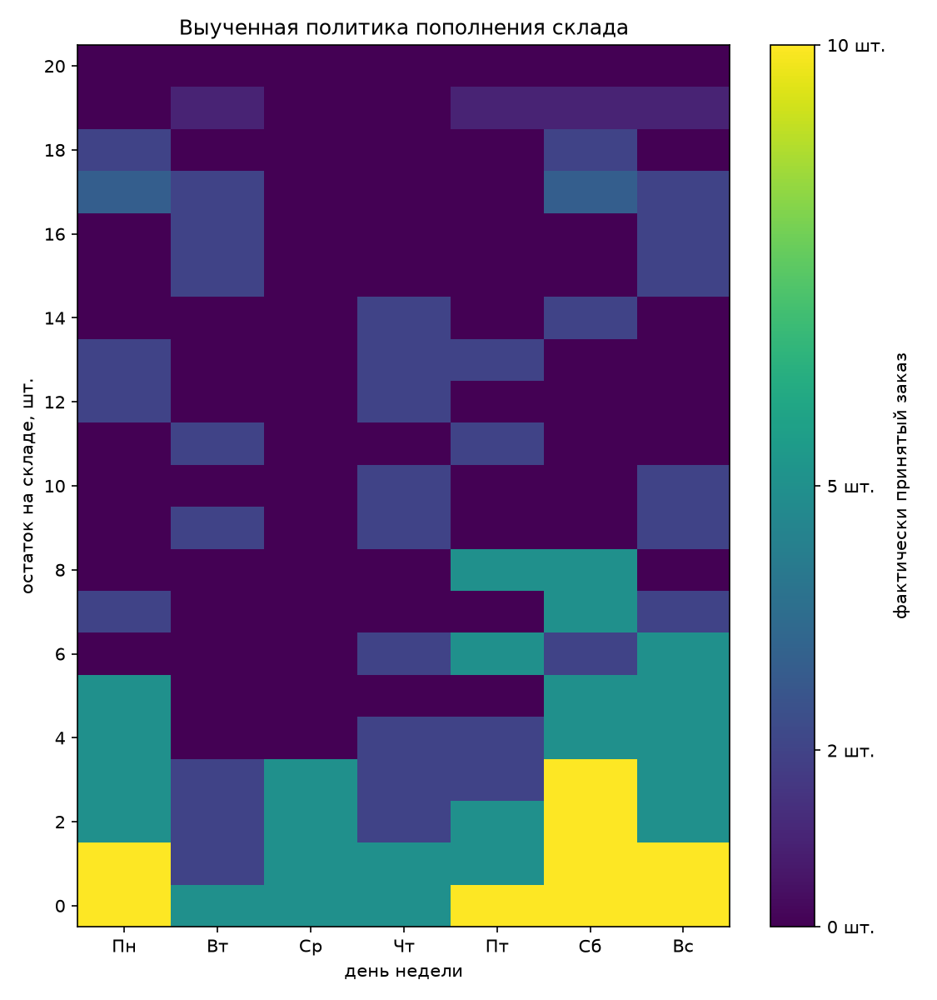
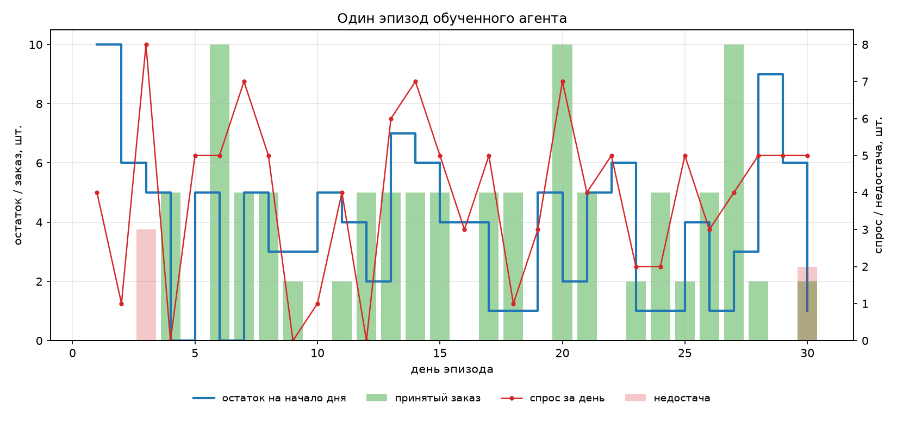

# Отчёт: обучение с подкреплением для управления запасами на складе

Работа выполнена по заданию «Изучение и применение алгоритмов обучения с подкреплением
для решения прикладной задачи». Из списка примеров выбрана задача
**«управление запасами на складе»**, метод решения — **табличный Q-learning**.

Все числа в отчёте получены запуском:

```powershell
python main.py all --episodes 10000 --seed 0
```

## 1. Постановка прикладной задачи

Небольшой магазин хранит на складе один вид товара. Ёмкость склада — 20 единиц.
В начале каждого дня менеджер принимает одно решение: сколько единиц заказать у поставщика —
`0`, `2`, `5` или `10`. Поставка приходит в тот же день (время поставки равно нулю),
после чего магазин сталкивается со случайным спросом покупателей, который в выходные
заметно выше, чем в будни.

Менеджеру нужно правило пополнения склада, максимизирующее прибыль за 30 дней:
слишком большой запас — деньги «замораживаются» и платится хранение, слишком маленький —
возникает дефицит и теряются продажи. Заранее выписать оптимальное правило нельзя:
спрос случаен, и выгодный заказ зависит от текущего остатка, дня недели и ожидаемого спроса.
Именно поэтому задача формулируется как задача обучения с подкреплением: агент
(менеджер) многократно проходит 30-дневные периоды, наблюдает результат своих решений
и постепенно находит стратегию.

## 2. Состояния и действия агента

**Множество состояний** `S = {(stock, day)}`:

* `stock ∈ {0, 1, ..., 20}` — остаток товара на складе в начале дня;
* `day ∈ {0, ..., 6}` — день недели (0 — понедельник);
* всего `|S| = 21 * 7 = 147` состояний, номер состояния `s = stock * 7 + day`
  (реализовано в `InventoryConfig.state_index`).

**Множество действий** `A = {0, 2, 5, 10}` — размер заказа в единицах товара, `|A| = 4`.
Действия дискретны и одинаковы во всех состояниях; заказ, превышающий свободное место,
принимается частично: `принято = min(заказ, 20 - остаток)`.

**Переходы между состояниями.** Внутри одного шага (дня) сначала приходит заказ,
затем — спрос, потом день недели сдвигается:

1. `остаток ← остаток + min(заказ, 20 - остаток)` — детерминированная часть;
2. `d ~ Poisson(demand_mean[day])`, где `demand_mean = (3, 3, 3, 3, 4, 6, 6)` — случайная часть;
3. `продано = min(остаток, d)`, `недостача = d - продано`, `остаток ← остаток - продано`;
4. `day ← (day + 1) mod 7`.

Переход стохастический: одно и то же действие в одном и том же состоянии может привести
к разным остаткам, потому что спрос случаен. Матрица переходов `P(s'|s, a)` в явном виде
не хранится — она задаётся генератором случайных чисел (`numpy.random.Generator.poisson`),
что эквивалентно моделированию из модели спроса.

**Условие завершения эпизода** — отработано 30 дней (`terminated=True` на 30-м шаге).
Горизонт фиксирован, поэтому среда возвращает `terminated`, а не `truncated`.
После завершения эпизод начинается заново из состояния `(10, Пн)`.

## 3. Функция вознаграждения

Награда начисляется каждый день и равна прибыли за этот день:

```
R(s, a) = price * продано
        - unit_cost * принято
        - fixed_order_cost * [принято > 0]
        - holding_cost * остаток_после
        - stockout_penalty * недостача
```

| Слагаемое | Коэффициент | Смысл |
|---|---|---|
| `price * продано` | 10 | выручка от проданных единиц |
| `-unit_cost * принято` | 6 | закупка фактически принятого товара |
| `-fixed_order_cost * [принято > 0]` | 2 | фиксированные издержки оформления заказа |
| `-holding_cost * остаток_после` | 0.4 | хранение каждой единицы остатка в сутки |
| `-stockout_penalty * недостача` | 6 | штраф за каждую неудовлетворённую единицу спроса |

Выбранные коэффициенты создают реальный компромисс: торговая маржа 4 единицы за товар,
хранение одной единицы 10 дней стоит 4 единицы (столько же, сколько маржа),
а дефицит стоит дороже маржи. Фиксированные издержки заказа делают невыгодными
мелкие частые заказы, поэтому оптимальная стратегия похожа на правило «(s, S)»:
заказывать много, когда остаток упал ниже порога, и ничего не заказывать, когда склад полон.
Дополнительного бонуса за завершение эпизода нет: все эпизоды имеют одинаковую длину,
и выигрыш полностью выражается суммой ежедневных наград.

## 4. Выбранный алгоритм обучения с подкреплением

Выбран **табличный Q-learning** — метод временных различий, рекомендуемый в задании.

**Обновление Q-функции** после перехода `(s, a, r, s')`:

```
Q(s, a) ← Q(s, a) + α * [ r + γ * max_a' Q(s', a') - Q(s, a) ]
```

для завершающего перехода бутстрэп отключается: `Q(s, a) ← Q(s, a) + α * [r - Q(s, a)]`.
Q-функция хранится таблицей размера `147 × 4` (`numpy.ndarray`), начальные значения — нули.

**Выбор действий** — ε-жадная стратегия: с вероятностью `ε` действие выбирается случайно
(исследование), иначе — действие с максимальной Q-оценкой (использование). Если несколько
действий имеют одинаковую оценку, выбирается любое из них равновероятно.

**Гиперпараметры** (класс `QLearningConfig`):

| Параметр | Значение | Пояснение |
|---|---|---|
| `α` (скорость обучения) | 0.1 | награда за день — порядка 10 единиц, шаг 0.1 даёт плавное усреднение |
| `γ` (дисконт) | 0.95 | горизонт 30 шагов, дисконт учитывает отдалённые последствия |
| `ε` | 1.0 → 0.05 | `ε ← max(0.05, 0.995 * ε)` после каждого эпизода |
| число эпизодов | 10 000 | награда выходит на плато примерно к 3 000–4 000 эпизодов |

**Обоснование выбора.** Пространство состояний мало (147) и дискретно, действий всего четыре,
поэтому таблица обучается за несколько секунд и полностью интерпретируема: по ней можно
построить карту политики и объяснить каждое решение. Q-learning — off-policy метод:
он учится по случайным (исследовательским) действиям и распространяет информацию
о выгодных действиях на соседние состояния, что важно при редких событиях (например,
при дефиците). Аппроксимация нейросетью (DQN) здесь избыточна: состояний меньше, чем
параметров у одного слоя, и потребовала бы гораздо больше данных и времени.

**Псевдокод** (реализация — `rl_inventory/training.py::train`):

```
Q[s, a] ← 0 для всех s, a;  ε ← 1.0
повторить 10 000 раз (эпизод):
    s ← reset()
    пока эпизод не завершён (30 дней):
        a ← ε-жадное действие по Q[s]
        s', r, done ← step(a)
        Q[s, a] ← Q[s, a] + α * (r + γ * max Q[s'] - Q[s, a])   # без бутстрэпа при done
        s ← s'
    ε ← max(ε_min, ε * ε_decay)
```

## 5. Исходный код программы

Программа разбита на модули; каждый содержит docstring и комментарии на русском.
Пакет `rl_inventory` не зависит от gymnasium — среда написана вручную на numpy.

| Файл | Назначение |
|---|---|
| `rl_inventory/config.py` | неизменяемые dataclass-параметры: среда, гиперпараметры, настройки запуска; проверка корректности значений |
| `rl_inventory/environment.py` | `InventoryEnv`: `reset()`, `step()`, модель спроса, расчёт награды |
| `rl_inventory/agents.py` | `TabularQLearning` (действие, обновление, затухание ε, сохранение/загрузка), `RandomAgent` |
| `rl_inventory/training.py` | `train()`, `evaluate()`, `run_episode()`, `History`, `EpisodeStats` |
| `rl_inventory/plots.py` | три графика (кривая обучения, карта политики, траектория эпизода) |
| `rl_inventory/utils.py` | скользящее среднее, сохранение JSON, создание каталогов |
| `main.py` | командный интерфейс: `train` / `evaluate` / `demo` / `all` |
| `tests/` | 18 unit-тестов: среда, формула Q-обновления, сериализация, короткий прогон обучения |

Ключевой фрагмент среды — расчёт награды и перехода (`environment.py`):

```python
ordered = cfg.order_options[action]
accepted = min(ordered, cfg.max_stock - self._stock)   # заказ ограничен свободным местом
self._stock += accepted

demand = int(self._rng.poisson(cfg.demand_mean[self._day]))   # случайный спрос
sold = min(self._stock, demand)
unmet = demand - sold
self._stock -= sold

revenue = cfg.price * sold
purchase_cost = cfg.unit_cost * accepted
if accepted > 0:
    purchase_cost += cfg.fixed_order_cost
holding_cost = cfg.holding_cost * self._stock
stockout_cost = cfg.stockout_penalty * unmet
reward = revenue - purchase_cost - holding_cost - stockout_cost
```

Ключевой фрагмент агента — обновление Q-функции (`agents.py`):

```python
target = float(reward)
if not done:                                  # бутстрэп только для незавершающего перехода
    target += self.cfg.gamma * float(np.max(self.q_table[next_state]))
td_error = target - float(self.q_table[state, action])
self.q_table[state, action] += self.cfg.alpha * td_error
return td_error
```

## 6. Результат обучения

### 6.1. Кривая обучения

Обучение: 10 000 эпизодов, около 6.7 с на CPU. Средняя награда за 100 эпизодов:

* первые 100 эпизодов — **255.73**;
* последние 100 эпизодов — **382.27** (рост на 49.5 %);
* итоговый `ε = 0.05`, доля дней с дефицитом за всё обучение — 11.6 %.



Светлая линия — награда за отдельный эпизод (разброс большой, потому что спрос случаен),
жирная — среднее за 100 эпизодов, пунктир — затухание `ε`. Видно, что агент быстро
выходит на плато за 3 000–4 000 эпизодов и дальше только уменьшает шум оценок.

### 6.2. Сравнение со случайной политикой

Оценка проводилась на 200 эпизодах с `ε = 0` (жадная политика); случайная политика
оценивалась на том же потоке спроса, поэтому сравнение честное.

| Метрика (200 эпизодов) | Q-learning | Случайная политика |
|---|---|---|
| Средняя награда за эпизод | **390.07 ± 44.13** | 241.09 ± 76.14 |
| Доля удовлетворённого спроса | **0.974** | 0.935 |
| Доля дней с дефицитом | **0.057** | 0.081 |
| Средний остаток на складе | **3.92** | 9.55 |
| Недостача за эпизод, шт. | **3.07** | 7.66 |

Обученный агент выигрывает 61.8 % награды и при этом держит средний запас в 2.4 раза
меньше: случайная политика «заваливает» склад товаром (платит за хранение) и всё равно
чаще попадает в дефицит, потому что действует без учёта дня недели.

### 6.3. Выученная политика



Политика читается как правило «(s, S)» с поправкой на день недели:

* при остатке 0–3 агент заказывает 5–10 единиц, причём в субботу и воскресенье —
  максимальные 10 (перед пиком спроса);
* при остатке 4–8 заказ 0–5, в будни чаще 0;
* при остатке 14 и выше — почти всегда 0 (хранение дороже, чем риск короткого дефицита);
* в состоянии «склад полон» (20) все действия эквивалентны: заказ физически не принимается.

Примеры Q-оценок (ожидаемая дисконтированная прибыль до конца эпизода):

| Состояние | `a=0` | `a=2` | `a=5` | `a=10` | Лучшее действие |
|---|---|---|---|---|---|
| остаток 1, понедельник | 95.16 | 105.82 | 106.80 | **114.29** | заказать 10 |
| остаток 0, воскресенье | 67.70 | 77.14 | 111.45 | **128.05** | заказать 10 |

Разница между действиями в одном состоянии — это и есть «знание», накопленное обучением:
именно она определяет выбор агента.

### 6.4. Один эпизод обученного агента



Жадный эпизод (30 дней): награда **394.00**, продано **112 из 117** единиц спроса,
дефицит всего в 2 днях из 30. На графике видно характерное поведение: агент не держит
большой запас, а «подвозит» товар к концу недели, когда ожидается повышенный спрос.

## 7. Вывод

С помощью табличного Q-обучения удалось получить работающую стратегию пополнения склада.
Средняя награда выросла с 255.73 (первые 100 эпизодов) до 382.27 (последние 100),
а на независимой оценке обученная политика даёт 390.07 ± 44.13 против 241.09 ± 76.14
у случайной при меньшем среднем запасе и меньшей доле дней с дефицитом.
Значит, агент нашёл осмысленный компромисс между издержками хранения и потерями
от дефицита, а не «заучил» последовательность действий.

Как накопленный опыт влияет на выбор действий: каждое обновление сдвигает оценку
`Q(s, a)` к фактически наблюдённой награде плюс дисконтированная оценка следующего
состояния. Поскольку эпизоды повторяются тысячи раз, редкие, но дорогие события
(дефицит со штрафом 6 за единицу) постепенно отражаются в оценках «заказывать мало»
и делают действия с заказом при низком остатке более выгодными. В начале обучения
`ε = 1` — агент действует почти случайно и собирает данные; к концу `ε = 0.05`,
и решения почти всегда принимаются по максимальной Q-оценке, то есть на основе
накопленного опыта. При этом опыт не «отключает» исследование полностью: остаточные
5 % случайных действий позволяют отслеживать изменения среды.

Ограничения работы: время поставки принято нулевым, склад хранит один товар,
средний спрос считается стационарным по дням недели. Естественные развития —
время поставки и «ожидающие поставки» в состоянии, несколько товаров с общей ёмкостью,
сезонность спроса, а также сравнение с SARSA (меньше переоценки) и DQN
для непрерывного размера заказа.

### Соответствие требованиям задания

| Требование | Где выполнено |
|---|---|
| 1. Постановка прикладной задачи | раздел 1 |
| 2. Описание состояний и действий | раздел 2, `config.py`, `environment.py` |
| 3. Описание функции вознаграждения | раздел 3, `InventoryEnv.step` |
| 4. Алгоритм и обоснование выбора | раздел 4, `agents.py::TabularQLearning` |
| 5. Исходный код с комментариями | `main.py`, пакет `rl_inventory`, раздел 5 |
| 6. Результат обучения (графики, визуализация) | раздел 6, каталог `outputs/` |
| 7. Вывод | раздел 7 |
